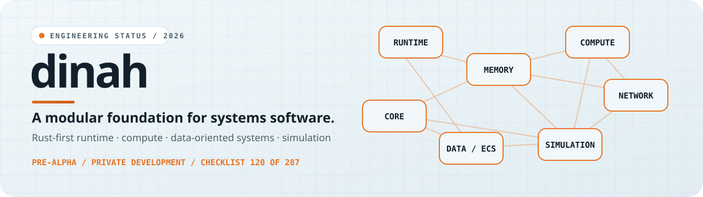

<div align="center">


<picture><source media="(prefers-color-scheme: dark)" srcset="assets/readme/dark/banner.svg"></picture>

[](https://github.com/lecodev-26/dinah/actions/workflows/ci.yml) [](https://github.com/lecodev-26/dinah/actions/workflows/benchmarks.yml) [](https://github.com/lecodev-26/dinah/actions/workflows/documentation-audit.yml) [](https://github.com/lecodev-26/dinah/blob/main/LICENSE-MIT)

<a href="roadmap.md"><picture><source media="(prefers-color-scheme: dark)" srcset="assets/readme/dark/b-roadmap.svg"></picture></a>&nbsp;<a href="puntos.md"><picture><source media="(prefers-color-scheme: dark)" srcset="assets/readme/dark/b-checklist.svg"></picture></a>&nbsp;<a href="docs"><picture><source media="(prefers-color-scheme: dark)" srcset="assets/readme/dark/b-docs.svg"></picture></a>&nbsp;<a href="artifacts/README.md"><picture><source media="(prefers-color-scheme: dark)" srcset="assets/readme/dark/b-artifacts.svg"></picture></a>

**A Rust-first foundation for runtime execution, compute, data-oriented systems and simulation.**<br>dinah is developed incrementally: planned features are not represented as implemented until code, tests, documentation and evidence support the claim.

</div>

> **Version status — updated 2026-10-14:** `dinah` is pre-alpha and remains in closed development. The Core, Compute and ECS foundations are still being refined; Simulation's first bounded models are implemented. Networking has entered its design phase, but no network transport or wire protocol is implemented yet. A passing CI run validates the current checks, not API stability, release readiness or performance guarantees.

<div align="center">

**Repository snapshot:** 120 / 287 checklist points complete · 8 in progress · 159 pending · 0 obsolete<br>
**Code snapshot:** approximately 6,100 Rust source lines · 201 test functions · 5 benchmark suites · 1 runnable example<br>
**Current milestone:** Networking API boundaries documented; transport and messages are next.

</div>

<div align="center">

<picture><source media="(prefers-color-scheme: dark)" srcset="assets/readme/dark/h-status.svg"></picture>

</div>

## ✨ What dinah is

dinah is a modular systems-software project written primarily in Rust. It is building reusable foundations for task execution, memory management, compute workloads, entity-component data and deterministic simulation, with networking and other systems planned in staged roadmap phases.

It is **not a game engine, operating system, cryptographic product or finished general-purpose runtime**. The roadmap expresses direction; the master checklist records the actual implementation state. Modules and APIs remain subject to change while the project is pre-alpha.

<div align="center">

<picture><source media="(prefers-color-scheme: dark)" srcset="assets/readme/dark/h-arch.svg"></picture>

</div>

<div align="center">

<picture><source media="(prefers-color-scheme: dark)" srcset="assets/readme/dark/layers.svg"></picture>

</div>

The architecture is layered so that components can evolve without circular dependencies or premature coupling. The currently implemented foundations are more mature than the networking, storage, native/hardware and security areas that remain in the roadmap.

<div align="center">

<picture><source media="(prefers-color-scheme: dark)" srcset="assets/readme/dark/h-principles.svg"></picture>

</div>

1. **Correctness before optimization.** Establish contracts, tests and failure behaviour before pursuing speed.
2. **Measure before claiming.** Benchmarks need reproducible inputs, recorded environments and retained CI artifacts.
3. **Rust-first and memory-safe.** C, C++ or Assembly are considered only when a measured technical need justifies them.
4. **Deterministic behaviour where promised.** Ordering, time, errors and state transitions must be explicit and tested.
5. **Small, justified dependency surface.** Dependencies need a concrete reason and a maintainable upgrade path.
6. **Evidence-driven roadmap.** A design document is not proof that a feature exists; checklist items close only with appropriate implementation and validation evidence.

<div align="center">

<picture><source media="(prefers-color-scheme: dark)" srcset="assets/readme/dark/h-map.svg"></picture>

</div>

| Component | What it contains |
|---|---|
| `src/core` | Shared types, IDs, configuration, states, errors and core contracts. |
| `src/runtime` | Tasks, workers, scheduler/executor, synchronization, cancellation, metrics and tracing. |
| `src/memory` | Buffers, contiguous storage and structure-of-arrays foundations. |
| `src/compute` | Sequential and parallel iteration, batches, reductions and pipelines. |
| `src/ecs` | Generational entities, `World`, component storage and access contracts. |
| `src/simulation` | Fixed-step clock, deterministic step contract, simulated entities and bounded physics/fluid/cellular/raycast/swarm models. |
| `docs/` | Module guides, design decisions, research, benchmark notes and engineering policies. |
| `tests/` · `benches/` · `examples/` | Integration tests, performance suites and runnable examples. |
| `scripts/` · `.github/workflows/` | Checklist/documentation checks, CI, benchmark matrix and artifact archiving. |
| `artifacts/` | Retained benchmark outputs and run metadata. |

**Requirements:** Rust stable and Git. The workspace uses Rust edition 2021. Platform-specific performance observations are collected by GitHub Actions; they should not be interpreted as universal hardware comparisons.

<div align="center">

<picture><source media="(prefers-color-scheme: dark)" srcset="assets/readme/dark/h-modules.svg"></picture>

</div>

| Module | Current state | Reference |
|---|---|---|
| **Core** | Shared types and contracts exist. Core v0.1 is not declared stable; first benchmarks and the final API-stability decision remain open. | [`docs/core.md`](docs/core.md) |
| **Runtime** | Scheduler, executor, task queues, parallel dispatch, synchronization, cancellation, task outcomes, metrics and tracing are implemented. | [`docs/runtime.md`](docs/runtime.md) |
| **Memory** | `Buffer<T>` and `SoaBuffer<A, B>` provide the initial buffer/storage abstractions; optimization remains evidence-driven. | [`docs/memory.md`](docs/memory.md) · [`docs/memory-model.md`](docs/memory-model.md) |
| **Compute** | Sequential/batched/parallel operations, reductions and `ComputePipeline` are implemented. SIMD remains open because results vary by platform and no production kernel currently justifies enabling it. | [`docs/compute.md`](docs/compute.md) · [`docs/simd-research.md`](docs/simd-research.md) |
| **Data / ECS** | Generational entities, `World`, sparse-set component storage and access-conflict planning exist. Full query and parallel-system execution work remains. | [`docs/ecs.md`](docs/ecs.md) · [`docs/ecs-benchmarks.md`](docs/ecs-benchmarks.md) |
| **Simulation** | Fixed-step clock, deterministic step contract, ECS bindings, replay tests and five bounded models: ASCII physics, scalar fluid diffusion, cellular automata, 2D raycasting and 2D flocking. These are focused models, not a general-purpose physics or CFD engine. | [`docs/simulation.md`](docs/simulation.md) |
| **Networking** | Design only: the initial API document defines layers and contracts. No transport, serialization, connection system or prediction implementation is claimed. | [`docs/network.md`](docs/network.md) |

<div align="center">

<picture><source media="(prefers-color-scheme: dark)" srcset="assets/readme/dark/h-bench.svg"></picture>

</div>

The current benchmark suite records median timings for the simulation clock, simulation step, mutable entity traversal and repeated linear searches. Values below come from a recorded five-platform CI matrix (workflow run [`38484605568`](https://github.com/lecodev-26/dinah/actions/runs/38484605568), commit `83cbcc3`). They are historical measurements of specific runners, not a controlled cross-OS comparison or a performance guarantee.

| Platform | Clock (ns/advance) | Step (ns/step) | Mutable walk (ns/entity) | 16 linear searches (ns/search) |
|---|---:|---:|---:|---:|
| Linux x86-64 | 7.801 | 12.547 | 0.368 | 2,437.000 |
| Linux ARM64 | 5.855 | 8.000 | 0.438 | 1,792.938 |
| Windows x86-64 | 7.836 | 12.242 | 0.346 | 2,446.062 |
| macOS x86-64 | 10.488 | 10.305 | 0.823 | 4,990.062 |
| macOS ARM64 | 2.395 | 6.012 | 0.281 | 1,533.875 |

These are medians of nine samples; construction is included in the clock and step cases. The lightweight compute kernel also demonstrated that dispatch overhead can make parallel execution slower than sequential execution. Benchmark history and metadata are archived under [`artifacts/benchmarks/`](artifacts/README.md). SIMD and data-oriented layout work remain open until representative workloads justify a change.

<div align="center">

<picture><source media="(prefers-color-scheme: dark)" srcset="assets/readme/dark/h-next.svg"></picture>

</div>

**Current phase — Phase 7: Networking.** Point 120, the initial API design, is complete. The next milestones are **121 — define transport** and **122 — define messages**, followed by serialization, connections, endpoints and state management. Phase 7 covers points 120–140; implementation is intentionally incremental.

**Eight points remain in progress:**

| Point | Area | Open work |
|---|---|---|
| 033 | Core | First benchmarks |
| 035 | Core | Stabilize Core v0.1 |
| 084 | Compute | SIMD only where a real benefit is demonstrated |
| 085 | Compute | Data-oriented layout optimization |
| 100 | Data / ECS | Validated and isolated parallel systems execution |
| 103 | Data / ECS | Further memory-access optimization and evidence |
| 220 | Testing | Integration tests |
| 225 | Testing | Benchmark suite |

After Networking, the roadmap proceeds through Storage, Native / Hardware, CLI, Observability and Security, followed by integration and the first `dinah` v0.1. Those are roadmap targets, not completed capabilities. See [`roadmap.md`](roadmap.md) and the [`287-point master checklist`](puntos.md) for exact statuses.

## 🛠 Development loop

<div align="center">

<picture><source media="(prefers-color-scheme: dark)" srcset="assets/readme/dark/cycle.svg"></picture>

</div>

The project follows a repeatable engineering loop: define the contract, implement the smallest useful slice, validate in CI, measure where relevant, document the result and update the checklist. GitHub Actions checks formatting, tests, Clippy, public documentation, checklist integrity and the benchmark/artifact workflows. The latest main-branch CI and artifact-archive runs for the README baseline passed on commit `163f8d7`:

- [CI run](https://github.com/lecodev-26/dinah/actions/runs/38487467664)
- [Artifact archive run](https://github.com/lecodev-26/dinah/actions/runs/38487528558)

## 🚀 Quick start

Clone the repository and inspect the workspace:

```bash
git clone https://github.com/lecodev-26/dinah.git
cd dinah
cargo metadata --no-deps --format-version 1
```

The library API is pre-alpha and can change between commits. Start with [`docs/compute.md`](docs/compute.md) or [`docs/simulation.md`](docs/simulation.md) for examples of currently implemented APIs. CI is the project's authoritative validation gate; benchmark claims should be checked against the associated run artifacts.

## 📜 License

Unless a file states otherwise, `dinah` is dual-licensed under either the MIT License ([`LICENSE-MIT`](LICENSE-MIT)) or the Apache License, Version 2.0 ([`LICENSE-APACHE`](LICENSE-APACHE)), at your option. Contributions intended for inclusion are offered under the same dual-license terms unless explicitly agreed otherwise.
