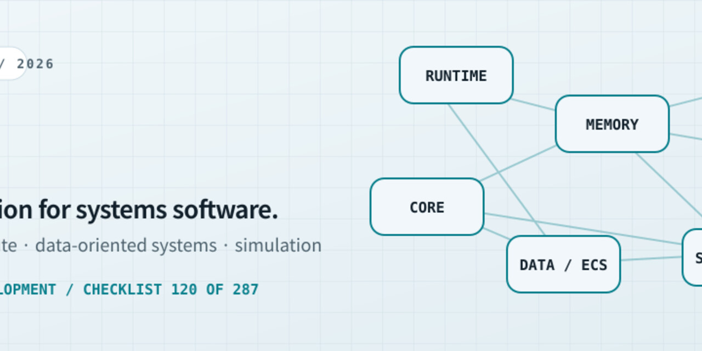
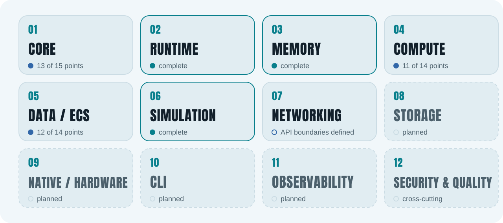
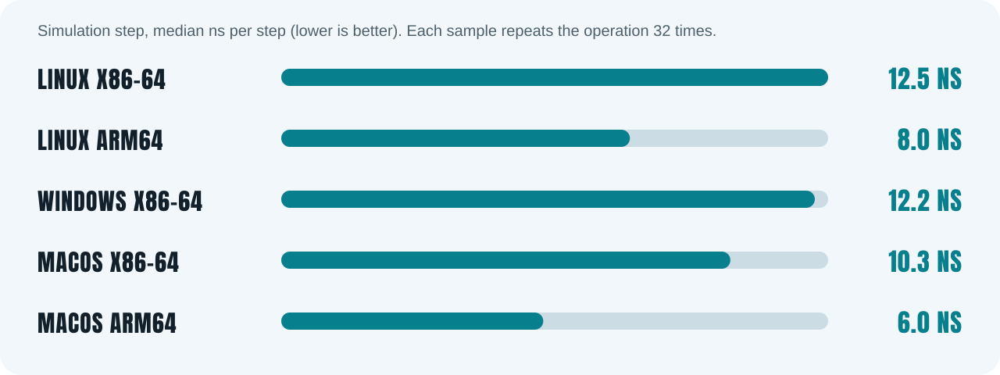
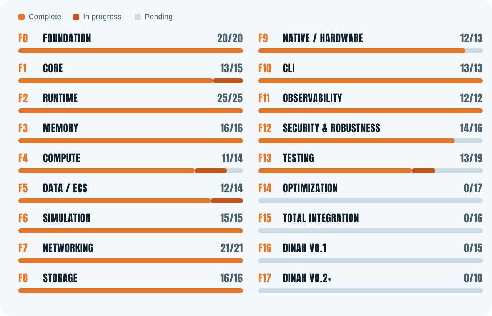

<div align="center">




[](https://github.com/lecodev-26/dinah/actions/workflows/ci.yml) [](https://github.com/lecodev-26/dinah/actions/workflows/benchmarks.yml) [](https://github.com/lecodev-26/dinah/actions/workflows/documentation-audit.yml) [](https://github.com/lecodev-26/dinah/blob/main/LICENSE-MIT)

<a href="roadmap.md"><picture><source media="(prefers-color-scheme: dark)" srcset="assets/dark/b-rel.svg"></picture></a>&nbsp;<a href="puntos.md"><picture><source media="(prefers-color-scheme: dark)" srcset="assets/dark/b-sec.svg"></picture></a>&nbsp;<a href="docs"><picture><source media="(prefers-color-scheme: dark)" srcset="assets/dark/b-docs.svg"></picture></a>&nbsp;<a href="artifacts/README.md"><picture><source media="(prefers-color-scheme: dark)" srcset="assets/dark/b-arena.svg"></picture></a>

**A modular Rust foundation for runtime execution, compute, data-oriented systems and simulation.**<br>A plain-language overview of DINAH's architecture, current implementation and roadmap.

</div>

> **Version status (updated 2026-10-14):** DINAH is pre-alpha and remains in active development. Core, Runtime, Memory, Compute and ECS foundations exist; Simulation's first five bounded models are implemented. Phase 7 (Networking) has completed points 120–126: API boundaries, the blocking byte-stream transport contract, logical message envelope and versioned binary wire format are documented; initial TCP connection and listening-endpoint wrappers are implemented. The wire encoder/decoder remains unimplemented; local connection lifecycle state is tracked. A green CI gate validates the checks that ran; it is not a claim of API stability, release readiness or performance guarantees.

<div align="center">

**Repository snapshot:** 287 master checklist points · 126 complete · 8 in progress · 153 pending
**Code snapshot:** single Rust crate · 5 benchmark suites (Runtime, Memory, Compute, ECS, Simulation) · 1 runnable example · five-platform benchmark history
**Current milestone:** Networking contracts and v1 wire format documented; initial blocking TCP connection and endpoint wrappers implemented; local connection lifecycle tracking is implemented; wire encoder/decoder remains pending.

</div>

<div align="center">

<picture><source media="(prefers-color-scheme: dark)" srcset="assets/dark/h-overview.svg"></picture>

</div>

DINAH is a modular systems-software project written primarily in Rust. It is building reusable foundations for task execution, memory management, compute workloads, entity-component data and deterministic simulation, with networking and other capabilities planned in staged roadmap phases.

| 🧩 Runtime | ⚙️ Compute | 🌐 Systems |
|---|---|---|
| Task scheduling, execution, synchronization and cancellation. | Sequential and parallel operations, batches, reductions and pipelines. | ECS foundations, bounded simulation models and a networking design in progress. |

DINAH is **not a finished general-purpose runtime or a game engine**. The roadmap expresses direction; the master checklist records implementation status. APIs can change while the project is pre-alpha.

<div align="center">

<picture><source media="(prefers-color-scheme: dark)" srcset="assets/dark/h-how.svg"></picture>

</div>

<div align="center">

<picture><source media="(prefers-color-scheme: dark)" srcset="assets/dark/flow.svg"></picture>

</div>

The design separates shared contracts from runtime execution, storage and compute concerns. Simulation builds on these foundations. Networking is currently a design boundary, not a completed network stack.

<div align="center">

<picture><source media="(prefers-color-scheme: dark)" srcset="assets/dark/h-principles.svg"></picture>

</div>

1. **Correctness before optimization.** Define contracts, failure behaviour and tests before tuning performance.
2. **Measure before claiming.** Benchmark results need reproducible inputs, recorded environments and retained artifacts.
3. **Rust-first and memory-safe.** Lower-level languages are considered only when a measured technical need justifies them.
4. **Determinism where promised.** Ordering, time, state transitions and error handling must be explicit and tested.
5. **Small, justified dependency surface.** Dependencies require a concrete purpose and a maintainable upgrade path.
6. **Evidence-driven progress.** A design document is not proof of implementation; checklist points close only with appropriate code and validation evidence.

<div align="center">

<picture><source media="(prefers-color-scheme: dark)" srcset="assets/dark/h-layout.svg"></picture>

</div>

| Component | What it contains |
|---|---|
| `src/core` | Shared types, IDs, configuration, states, errors and core contracts. |
| `src/runtime` | Tasks, workers, scheduler/executor, synchronization, cancellation, metrics and tracing. |
| `src/memory` | Buffers, contiguous storage and structure-of-arrays foundations. |
| `src/compute` | Sequential and parallel iteration, batches, reductions and pipelines. |
| `src/ecs` | Generational entities, `World`, component storage and access contracts. |
| `src/simulation` | Fixed-step clock, deterministic step contract and bounded physics/fluid/cellular/raycast/swarm models. |
| `docs/` | Module guides, design decisions, research, benchmark notes and engineering policies. |
| `tests/` · `benches/` · `examples/` | Tests, performance suites and runnable examples. |
| `scripts/` · `.github/workflows/` | Checklist/documentation checks, CI, benchmark matrix and artifact archiving. |
| `artifacts/` | Retained benchmark outputs and run metadata. |

**Requirements:** Rust stable and Git. The crate uses Rust edition 2021. Platform-specific performance measurements are collected by CI and are not universal hardware comparisons.

<div align="center">

<picture><source media="(prefers-color-scheme: dark)" srcset="assets/dark/h-crypto.svg"></picture>

</div>

| Module | Current state | Reference |
|---|---|---|
| **Core** | Shared types and contracts exist. Core v0.1 is not declared stable; first benchmarks and API-stability decisions remain open. | [`docs/core.md`](docs/core.md) |
| **Runtime** | Scheduler, executor, task queues, parallel dispatch, synchronization, cancellation, outcomes, metrics and tracing are implemented. | [`docs/runtime.md`](docs/runtime.md) |
| **Memory** | `Buffer<T>` and `SoaBuffer<A, B>` provide initial buffer/storage abstractions; optimization remains evidence-driven. | [`docs/memory.md`](docs/memory.md) · [`docs/memory-model.md`](docs/memory-model.md) |
| **Compute** | Sequential/batched/parallel operations, reductions and `ComputePipeline` exist. SIMD remains open until a real kernel demonstrates benefit with evidence. | [`docs/compute.md`](docs/compute.md) · [`docs/simd-research.md`](docs/simd-research.md) |
| **Data / ECS** | Generational entities, `World`, sparse-set component storage and access-conflict planning exist. Full query and parallel-system execution work remains. | [`docs/ecs.md`](docs/ecs.md) · [`docs/ecs-benchmarks.md`](docs/ecs-benchmarks.md) |
| **Simulation** | Fixed-step clock, deterministic step contract, ECS bindings, replay tests and five bounded models: ASCII physics, scalar fluid diffusion, cellular automata, 2D raycasting and 2D flocking. Not a general-purpose physics or CFD engine. | [`docs/simulation.md`](docs/simulation.md) |
| **Networking** | Initial blocking TCP connection and listening-endpoint wrappers exist. Wire encoder/decoder remains unimplemented; local connection lifecycle state is tracked. | [`docs/network.md`](docs/network.md) |

<div align="center">

<picture><source media="(prefers-color-scheme: dark)" srcset="assets/dark/h-status.svg"></picture>

</div>

**Implemented foundations include:** runtime scheduling and task execution; memory buffers; sequential and parallel compute operations; generational ECS entities and sparse-set component storage; fixed-step simulation and five focused simulation models; CI, benchmark and documentation workflows.

**Not yet complete:** stable public APIs, a production SIMD kernel, full parallel ECS system execution, transport and serialization for networking, storage, native/hardware integrations, CLI, observability and security roadmap phases, and the first v0.1 integration milestone. See the master checklist for exact status rather than treating planned work as shipped.

<div align="center">

<picture><source media="(prefers-color-scheme: dark)" srcset="assets/dark/h-bench.svg"></picture>

</div>

DINAH tracks median timings for the simulation clock, simulation step, mutable entity traversal and repeated linear searches. The recorded five-platform CI matrix below is historical evidence from workflow run [`38484605568`](https://github.com/lecodev-26/dinah/actions/runs/38484605568), commit `83cbcc3`; it is not a controlled cross-OS comparison or a performance guarantee. Lower timings are better for these measurements.

<div align="center">

<picture><source media="(prefers-color-scheme: dark)" srcset="assets/dark/bars.svg"></picture>

</div>

| Platform | Clock (ns/advance) | Step (ns/step) | Mutable walk (ns/entity) | 16 linear searches (ns/search) |
|---|---:|---:|---:|---:|
| Linux x86-64 | 7.801 | 12.547 | 0.368 | 2,437.000 |
| Linux ARM64 | 5.855 | 8.000 | 0.438 | 1,792.938 |
| Windows x86-64 | 7.836 | 12.242 | 0.346 | 2,446.062 |
| macOS x86-64 | 10.488 | 10.305 | 0.823 | 4,990.062 |
| macOS ARM64 | 2.395 | 6.012 | 0.281 | 1,533.875 |

These are medians of nine samples; construction is included in the clock and step cases. A lightweight compute kernel also showed that dispatch overhead can make parallel execution slower than sequential execution. Benchmark history and metadata are archived in [`artifacts/README.md`](artifacts/README.md). SIMD and data-oriented layout work remain open until representative workloads justify changes.

<div align="center">

<picture><source media="(prefers-color-scheme: dark)" srcset="assets/dark/h-versions.svg"></picture>

</div>

<div align="center">

<picture><source media="(prefers-color-scheme: dark)" srcset="assets/dark/versions.svg"></picture>

</div>

**Current phase — Phase 7: Networking.** Points 120–126 are complete: API boundaries, blocking byte-stream transport contract, logical message envelope, versioned binary wire format, and initial TCP connection/listening-endpoint wrappers. The next milestone is **127 — investigate client-side prediction**. Phase 7 spans points 120–140 and will be implemented incrementally.

**Eight points remain in progress:**

| Point | Area | Open work |
|---|---|---|
| 033 | Core | First benchmarks |
| 035 | Core | Stabilize Core v0.1 |
| 084 | Compute | SIMD only where a real benefit is demonstrated |
| 085 | Compute | Data-oriented layout optimization |
| 100 | Data / ECS | Validated and isolated parallel systems execution |
| 103 | Data / ECS | Further memory-access optimization and evidence |
| 220 | Testing | Integration tests |
| 225 | Testing | Benchmark suite |

After Networking, the roadmap continues through Storage, Native / Hardware, CLI, Observability and Security, then integration and the first `dinah` v0.1. These are targets, not completed capabilities. See [`roadmap.md`](roadmap.md) and the [`287-point master checklist`](puntos.md).

<div align="center">

<picture><source media="(prefers-color-scheme: dark)" srcset="assets/dark/h-quick.svg"></picture>

</div>

```bash
git clone https://github.com/lecodev-26/dinah.git
cd dinah
cargo metadata --no-deps --format-version 1
```

The library API is pre-alpha and can change between commits. Start with [`docs/compute.md`](docs/compute.md) or [`docs/simulation.md`](docs/simulation.md) for implemented APIs. CI is the validation gate; benchmark claims should be checked against the corresponding run artifacts.

<div align="center">

<picture><source media="(prefers-color-scheme: dark)" srcset="assets/dark/h-docs.svg"></picture>

</div>

| Document | Covers |
|---|---|
| [Core](docs/core.md) | Shared types and contracts |
| [Runtime](docs/runtime.md) | Scheduling, tasks and execution |
| [Memory](docs/memory.md) · [Memory model](docs/memory-model.md) | Buffer and storage foundations |
| [Compute](docs/compute.md) · [SIMD research](docs/simd-research.md) | Compute operations and SIMD evidence |
| [ECS](docs/ecs.md) | Entities, components and access contracts |
| [Simulation](docs/simulation.md) | Simulation models and deterministic stepping |
| [Networking](docs/network.md) | Initial API design and boundaries |
| [Roadmap](roadmap.md) · [Master checklist](puntos.md) | Phases, milestones and status |
| [Artifacts](artifacts/README.md) | Benchmark artifact archive |

<div align="center">

<picture><source media="(prefers-color-scheme: dark)" srcset="assets/dark/h-assurance.svg"></picture>

</div>

CI is used to validate code and documentation incrementally. Passing CI is evidence that the configured checks passed for a particular commit; it does not certify production readiness, API stability or a performance level.

| ✅ What the project tracks | ❌ What is not claimed |
|---|---|
| Automated CI and checklist integrity | Stable public API or v0.1 release |
| Multi-platform benchmark evidence | Universal performance leadership |
| Focused deterministic simulation tests | General-purpose physics or CFD capability |
| Documented networking API boundaries | A completed network stack or wire protocol |
| A phased, auditable master checklist | That roadmap items are already implemented |

<div align="center">

<picture><source media="(prefers-color-scheme: dark)" srcset="assets/dark/h-license.svg"></picture>

</div>

Unless a file states otherwise, DINAH is dual-licensed under your choice of the [MIT License](LICENSE-MIT) or the [Apache License, Version 2.0](LICENSE-APACHE). Contributions intended for inclusion follow the same dual-license terms unless explicitly agreed otherwise.
