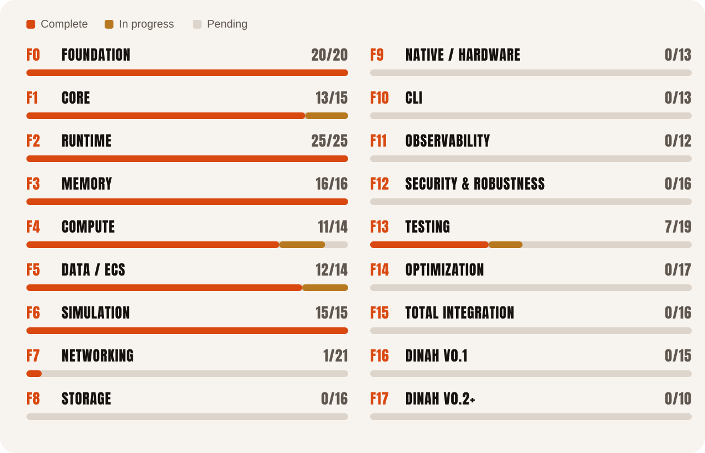

<picture><source media="(prefers-color-scheme: dark)" srcset="assets/readme/dark/hero.svg"></picture>

<a href="roadmap.md"><picture><source media="(prefers-color-scheme: dark)" srcset="assets/readme/dark/b-roadmap.svg"></picture></a>&nbsp;<a href="puntos.md"><picture><source media="(prefers-color-scheme: dark)" srcset="assets/readme/dark/b-checklist.svg"></picture></a>&nbsp;<a href="docs"><picture><source media="(prefers-color-scheme: dark)" srcset="assets/readme/dark/b-docs.svg"></picture></a>&nbsp;<a href="artifacts/README.md"><picture><source media="(prefers-color-scheme: dark)" srcset="assets/readme/dark/b-artifacts.svg"></picture></a>&nbsp;<a href="https://github.com/lecodev-26/dinah/actions"><picture><source media="(prefers-color-scheme: dark)" srcset="assets/readme/dark/b-ci.svg"></picture></a>

**dinah** is a Rust-first project exploring a high-performance runtime and a modular foundation for compute, data-oriented processing, simulation, networking and storage. `dinah` is the lowercase project name and visual identity.

<picture><source media="(prefers-color-scheme: dark)" srcset="assets/readme/dark/h-status.svg"></picture>

> **Pre-alpha, foundation stage (2026-10-14).** The roadmap is ambitious by design. Modules are introduced only when their interfaces, tests, benchmarks and use cases justify them, and a planned capability is not considered implemented until code, tests, documentation and evidence exist.

| | |
|---|---|
| **Checklist** | 120 of 287 points complete, 8 in progress, 159 pending, 0 obsolete |
| **Phases complete** | 0 Foundation, 2 Runtime, 3 Memory, 6 Simulation |
| **Almost there** | 1 Core (13/15), 4 Compute (11/14), 5 Data / ECS (12/14) |
| **Just started** | 7 Networking: API boundaries defined (point 120) |
| **CI on `main`** | passing on the latest runs: format, tests, Clippy, docs, checklist validation, benchmark matrix and artifact archive |
| **Code** | about 6,100 lines of Rust in `src/`, 201 test functions, 5 benchmark suites, 1 runnable example |
| **Visibility** | private repository during closed development |

<picture><source media="(prefers-color-scheme: dark)" srcset="assets/readme/dark/stats.svg"></picture>

<picture><source media="(prefers-color-scheme: dark)" srcset="assets/readme/dark/h-progress.svg"></picture>

<picture><source media="(prefers-color-scheme: dark)" srcset="assets/readme/dark/phases.svg"></picture>

The master checklist is [`puntos.md`](puntos.md): 287 numbered points. Point IDs are permanent, so completed, pending or obsolete items are never renumbered. The narrative plan, architecture and phase sequencing live in [`roadmap.md`](roadmap.md).

<picture><source media="(prefers-color-scheme: dark)" srcset="assets/readme/dark/h-arch.svg"></picture>

<picture><source media="(prefers-color-scheme: dark)" srcset="assets/readme/dark/layers.svg"></picture>

The layers are design goals that can evolve independently. Circular dependencies and premature public APIs are avoided, and dinah is, by definition, not a game engine or an operating system.

<picture><source media="(prefers-color-scheme: dark)" srcset="assets/readme/dark/h-modules.svg"></picture>

| Module | Implemented so far | Guide |
|---|---|---|
| **Core** | `dinah::core`: validated configuration, non-null IDs, lifecycle states and shared validation contracts. Not declared stable until the planned review and validation finish. | [core.md](docs/core.md) |
| **Runtime** | Executor, scheduler, queues, synchronization, task outcomes, cancellation, task states, metrics and tracing. | [runtime.md](docs/runtime.md) |
| **Memory** | `Buffer<T>` and `SoaBuffer<A, B>`, with documented limits and benchmarks. | [memory.md](docs/memory.md) · [memory-model.md](docs/memory-model.md) |
| **Compute** | `for_each`, `for_each_batch`, `for_each_parallel`, `map`, `try_reduce`, `try_reduce_parallel` and `ComputePipeline`, with execution, ownership and error contracts. | [compute.md](docs/compute.md) |
| **Data / ECS** | Generational entity identity, sparse-set storage, `World`, queries and access contracts. | [ecs.md](docs/ecs.md) · [ecs-benchmarks.md](docs/ecs-benchmarks.md) |
| **Simulation** | `SimulationClock` with a fixed non-zero delta, deterministic `Simulation::step`, simulated entities bridged to ECS, and five bounded domain models: ASCII physics, cellular automata, raycasting, fluid and swarm. | [simulation.md](docs/simulation.md) |
| **Networking** | Design only: [network.md](docs/network.md) fixes layers, ownership, framing, message limits, errors, time, concurrency, shutdown, security and determinism. No transport yet. | [network.md](docs/network.md) |

<picture><source media="(prefers-color-scheme: dark)" srcset="assets/readme/dark/h-bench.svg"></picture>

<picture><source media="(prefers-color-scheme: dark)" srcset="assets/readme/dark/bench.svg"></picture>

| Platform | Clock (ns/advance) | Step (ns/step) | Mutable walk (ns/entity) | 16 linear searches (ns/search) |
|---|---:|---:|---:|---:|
| Linux x86-64 | 7.801 | 12.547 | 0.368 | 2,437.000 |
| Linux ARM64 | 5.855 | 8.000 | 0.438 | 1,792.938 |
| Windows x86-64 | 7.836 | 12.242 | 0.346 | 2,446.062 |
| macOS x86-64 | 10.488 | 10.305 | 0.823 | 4,990.062 |
| macOS ARM64 | 2.395 | 6.012 | 0.281 | 1,533.875 |

These are medians of nine samples from the CI benchmark matrix (workflow run 38484605568, commit `83cbcc3`). They are observations of specific machines and builds, not guarantees or controlled comparisons between operating systems, and construction is included in the clock and step cases. Performance claims in this project require recorded environment metadata, repeatable measurements and CI artifacts. Archived runs for 23 commits live under [`artifacts/benchmarks/`](artifacts/README.md).

<picture><source media="(prefers-color-scheme: dark)" srcset="assets/readme/dark/h-next.svg"></picture>

**Phase 7, Networking.** The API boundaries are defined (point 120). Next come the transport (121) and the messages (122), then the rest of the 21 points.

**Eight points are in progress:**

| Point | Area | Work |
|---|---|---|
| 033 | Core | First benchmarks |
| 035 | Core | Stabilize Core v0.1 |
| 084 | Compute | SIMD where it brings a real benefit |
| 085 | Compute | Data-oriented structures |
| 100 | Data / ECS | Parallel systems |
| 103 | Data / ECS | Memory access optimization |
| 220 | Testing | Integration tests |
| 225 | Testing | Benchmark suite |

Point 086 (performance metrics for Compute) is still pending. After networking come Storage, Native / Hardware, the CLI, Observability and Security, then total integration and the first `dinah` v0.1.

<picture><source media="(prefers-color-scheme: dark)" srcset="assets/readme/dark/h-principles.svg"></picture>

<picture><source media="(prefers-color-scheme: dark)" srcset="assets/readme/dark/cycle.svg"></picture>

- Rust is the primary implementation language. C, C++ and Assembly are used only where a measured technical need justifies them.
- Measure before optimizing, and make benchmarks reproducible.
- Correctness, memory safety, determinism and clear APIs come before speculative optimization.
- Dependencies must be justified and kept maintainable.
- The roadmap describes intent. `puntos.md` is the living, auditable implementation checklist.
- CI runs formatting, compilation, tests, Clippy and documentation validation on GitHub Actions, so no local build is required. Exploratory benchmarks may run locally, but claims need CI artifacts.

Benchmark artifacts are archived under `artifacts/benchmarks/<commit-sha>/run-<benchmark-run-id>/` only after both CI and the benchmark matrix succeed. See the [artifact policy](artifacts/README.md) and the [automation and bots policy](docs/automation-policy.md).

<picture><source media="(prefers-color-scheme: dark)" srcset="assets/readme/dark/h-map.svg"></picture>

| Path | What it is |
|---|---|
| [`roadmap.md`](roadmap.md) | Project purpose, architecture, phases and sequencing |
| [`puntos.md`](puntos.md) | Master checklist and development status |
| [`src/`](src) | The library: `core`, `runtime`, `memory`, `compute`, `ecs`, `simulation` |
| [`tests/`](tests) | Contract and integration tests |
| [`benches/`](benches) | Runtime, memory, compute, ECS and simulation benchmarks |
| [`examples/`](examples) | `simulation_basics`, a runnable example |
| [`docs/`](docs) | Design guides, SIMD and data-oriented research, ECS benchmarks, reports |
| [`scripts/`](scripts) | Checklist validation, documentation audit and benchmark runner |
| [`artifacts/`](artifacts/README.md) | Archived benchmark results |
| [`.github/workflows/`](.github/workflows) | CI, benchmarks, artifact archive and documentation audit |
| [`assets/dinah-mark.svg`](assets/dinah-mark.svg) | The project mark: a minimal lowercase `d` monogram |

<picture><source media="(prefers-color-scheme: dark)" srcset="assets/readme/dark/h-license.svg"></picture>

Unless a file states otherwise, `dinah` is dual-licensed under either the MIT License ([`LICENSE-MIT`](LICENSE-MIT)) or the Apache License, Version 2.0 ([`LICENSE-APACHE`](LICENSE-APACHE)), at your option. Contributions intended for inclusion are offered under the same dual-license terms unless explicitly agreed otherwise.
